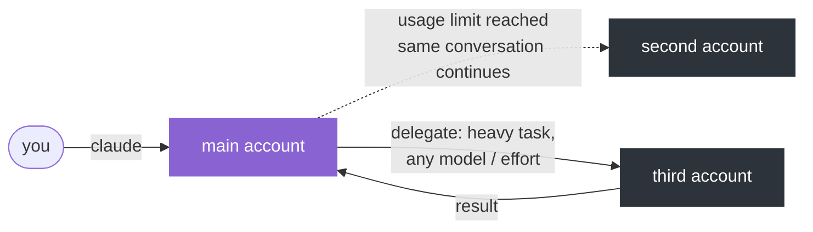
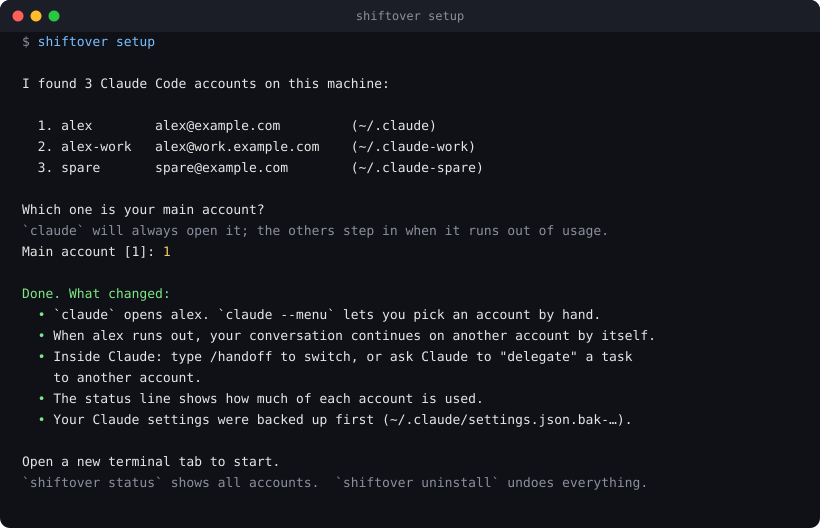
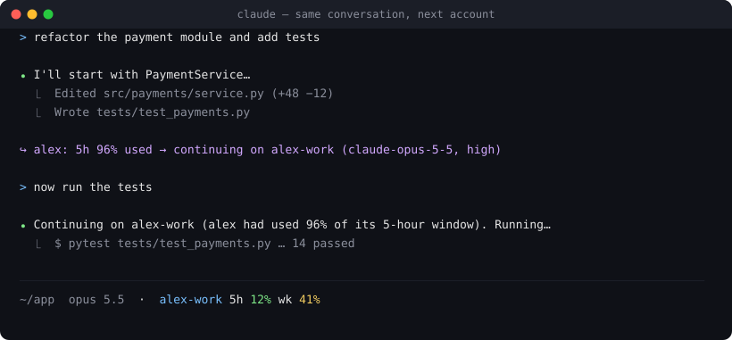
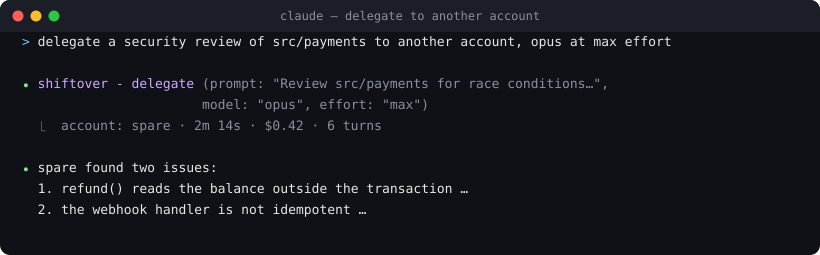
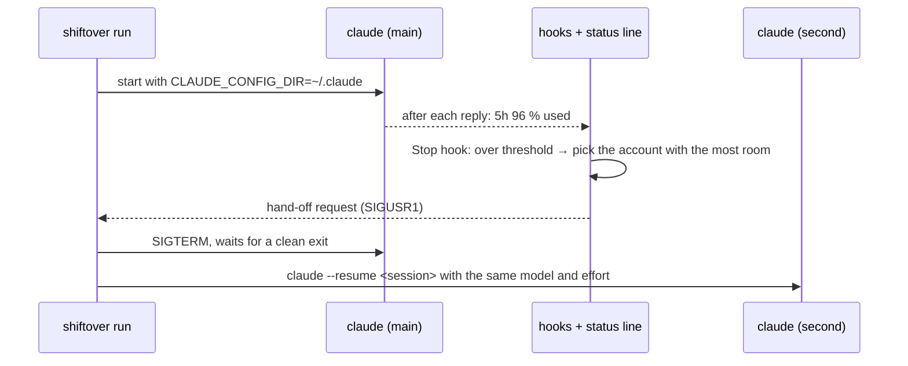

# shiftover

[](pyproject.toml)
[](pyproject.toml)
[](https://docs.claude.com/en/docs/claude-code)
[](LICENSE)

**Several Claude Code accounts on one Mac, used like one.** Your main account always drives. When it runs out of
usage, the *same conversation* continues on the next account by itself. From inside any session, Claude can hand a heavy
task to another account with the model and effort you choose, and bring the answer back.



Everything runs locally. Each account keeps its own sign-in, its own directory and its own quota; what the accounts
share is your setup (skills, settings, commands) and the conversation transcripts, so any of them can pick a conversation
up. shiftover only decides which one `claude` starts and keeps the conversation moving. If the OpenAI Codex CLI is
installed, Claude can delegate to it as well.

## Install

```bash
pipx install git+https://github.com/protonmob/shiftover   # or: uv tool install git+https://github.com/protonmob/shiftover
shiftover setup
```

`setup` finds every signed-in account, asks which one is yours by default and whether any should stay out of the pool
(a work account, say), wires everything and tells you what changed:

<p align="center"></p>

Open a new terminal tab afterwards; `claude` now goes through shiftover. Don't have a second account directory yet?
`shiftover add work` creates `~/.claude-work`, shares your skills, settings and sessions with it, and opens the sign-in.
Run `shiftover setup` again when an account is added or removed; every step is idempotent.

### If an AI agent is installing this for you

Claude Code (or any agent) can do the whole install: the two commands above are all it takes. Notes for the agent:

- `shiftover setup` reads each directory's signed-in e-mail itself and asks its questions in the terminal. Without a
  terminal it prints the accounts it found and stops; run it again as `shiftover setup --main <name>`.
- Which accounts go into the pool is the user's decision, not something to establish. `setup` lists what it found and
  asks which should stay out; `shiftover remove <name>` drops one for good.
- An account that must stay separate (an employer's, for instance) is answered to the "keep out" question or set with
  `pool = false` in the config. It is then opened only on request (`claude -a work` or a folder rule,
  `shiftover map add ~/Projects/work work`) and never used for a hand-off or a delegate.
- An existing `claude()` function or alias in the shell rc is superseded by `eval "$(shiftover shell-init)"`. Keep any
  "this folder → that account" rule it had with `shiftover map add <dir> <account>` instead of a custom function.
- Nothing in `~/.config/shiftover/config.toml` needs to be typed by hand; `setup` and `doctor` fill it in.
- Already-open Claude Code sessions do not see the hooks or the `delegate` tool; a new session does.

## What you'll see

**Hand-off.** At the end of a turn, when the active account is at the threshold (95 % by default) or Claude Code
reports a rate limit, the conversation is resumed on the account with the most room, same history, same model, same
effort. One line tells you it happened. `/handoff [account] [model] [effort]` does it on demand.

<p align="center"></p>

**Delegate.** Claude gets three tools (`accounts`, `delegate`, `monitor`). A delegate is a headless Claude Code run on
another account; the answer comes back into your session, long jobs run in the background. With the
[OpenAI Codex CLI](https://github.com/openai/codex) installed, `delegate(account="codex")` runs the task on Codex
instead, on its own subscription, with the same job tracking.

<p align="center"></p>

**Tips and status.** When it matters, Claude hears one factual line, such as *alex has used 88 % of its 5-hour window;
spare has 80 % room*, and passes it on. The status line always shows the active account and its windows
(`alex 5h 78% wk 41%`). `shiftover status` prints every account.

**Quality of life.** Directory → account rules, `sync-mcp` to copy local MCP servers between accounts, `doctor`, an
arrow-key picker (`cl`), English or Turkish messages.

## Requirements

- macOS (Linux should work but is untested; credentials are read through the macOS Keychain or `.credentials.json`)
- Claude Code ≥ 2.1.224 on `PATH`
- Python ≥ 3.11 (`pipx` or `uv` bring their own)
- Two or more claude.ai accounts, each signed into its own config directory (`~/.claude`, `~/.claude-work`, …)

## How it works

Under the hood `setup` does four things: installs four hooks and a status-line command into Claude Code's
`settings.json` (backed up first), registers the `shiftover` MCP server in every account, copies the `/handoff` command
and a skill, and adds `eval "$(shiftover shell-init)"` to your shell rc so that `claude` runs `shiftover run`.
The pieces are available separately as `shiftover init --import`, `shiftover install` and `shiftover shell-init`.



- The status line Claude Code already renders carries `rate_limits.five_hour` / `seven_day` for the active account.
  shiftover's status line command stores them per session and appends `account 5h 78% wk 41%` to whatever status line
  you had before.
- The `Stop` hook runs after every turn. If the stored usage is at or above `threshold`, or a `StopFailure` with
  `rate_limit` fires, the hook picks the account with the most headroom for the session's model, writes a hand-off
  request and signals the wrapper. The wrapper ends the `claude` process and starts `claude --resume <session-id>` under the
  other account with the same flags. Transcripts are shared between accounts (symlinked `projects/`), so the conversation
  is intact. If no account has headroom, nothing happens and Claude Code's own wait-for-reset behaviour takes over.
- Other accounts' windows come from the OAuth usage endpoint Claude Code itself uses, read with each account's own token,
  cached for five minutes. It is not a documented API; when it fails shiftover degrades to the official data it has.
- `delegate` runs `claude -p --output-format json` under the chosen account. Nothing from the calling conversation is
  shared except the prompt you write.

## Commands

| Command | What it does |
| --- | --- |
| `shiftover run [--menu] [-a ACCOUNT] [claude args…]` | what the `claude` shell function calls; `--menu` shows the picker, `SHIFTOVER_ACCOUNT=name` forces an account |
| `shiftover status [--refresh] [--json]` | accounts with their windows |
| `shiftover doctor` | sign-in drift, shared directories, hooks, MCP registration, shell wiring |
| `shiftover setup [--main NAME] [--no-install] [--no-shell]` | scan, pick the main account, install, wire the shell |
| `shiftover init --import [--main NAME] [--name DIR=NAME…]` | create the config only |
| `shiftover add NAME [--dir D] [--no-share] [--main]` / `remove NAME` | add a directory and sign in / drop one for good (`setup` will not re-add it) |
| `shiftover install [--dry-run]` / `uninstall` | wire into / out of Claude Code |
| `shiftover handoff [ACCOUNT] [--model M] [--effort E]` | what `/handoff` runs; takes effect when the turn ends |
| `shiftover map add DIR ACCOUNT` / `map remove DIR` / `map` | directory → account rules |
| `shiftover sync-mcp [--from A] [--to B\|all] [--overwrite]` | copy `mcpServers` definitions between accounts |
| `shiftover jobs [--show ID] [--cancel ID] [--purge]` | delegate jobs |
| `shiftover shell-init` | prints the `claude()` / `cl()` shell functions |

## Config

`~/.config/shiftover/config.toml` (see [`config.example.toml`](config.example.toml)):

```toml
main = "main"
threshold = 95
lang = "en"

[accounts.main]
dir = "~/.claude"
email = "you@example.com"

[accounts.second]
dir = "~/.claude-second"
email = "you+2@example.com"
models = ["opus", "sonnet"]      # optional: this account is skipped when another model is requested

[accounts.work]
dir = "~/.claude-work"
email = "you@work.example"
pool = false                     # opened only on request; never a hand-off or delegate target

[handoff]
mode = "auto"                    # auto | ask | off

[delegate]
wait_seconds = 90                # foreground wait before a job goes to the background
permission_mode = "default"
mcp = "none"                     # main: give delegates the main account's local MCP servers
allow_bypass = false

[tips]
enabled = true
min_interval_min = 10
levels = [75, 90]

[statusline]
wrap = "bash ~/.claude/my-statusline.sh"   # filled in by `install` from your existing status line

[codex]
enabled = true                   # offer the Codex CLI as delegate target "codex" when it is installed

[map]
"~/work/acme" = "work"
```

`email` is what `doctor` and the picker compare against: `/login` takes whatever account the browser has open, so a
directory can silently end up holding the wrong account.

## The delegate tool

Once installed, every account has an MCP server named `shiftover`. The bundled skill tells Claude how to use it; the
short version:

```
delegate(prompt="Review src/payments for race conditions. Repo: /Users/me/app. Return findings as a markdown list.",
         model="opus", effort="max", permission_mode="default")
delegate(prompt="…", background=true)          → job_id
monitor(job_ids=["20261022-141503-a1b2"], wait_seconds=120)
accounts()
```

- `account="auto"` (default) picks the account with the most headroom for the requested model, never the calling one
  and never an account kept out of the pool. `account="codex"` runs the task on the OpenAI Codex CLI; `permission_mode`
  maps onto Codex's sandbox (`default` → read-only, `acceptEdits` → workspace-write).
- A delegate sees only the prompt. Put the goal, paths, constraints and the output format in it.
- Nobody answers permission prompts in a delegate: read-only work needs nothing, file edits need `permission_mode="acceptEdits"`.
- claude.ai connectors (Gmail, Amplitude, the browser extension, …) are not available in a delegate; do that part in the
  session and delegate the heavy reasoning with the data in the prompt or in files.
- Each delegate spends the target account's quota. Results longer than 8 KB are truncated in the tool result and kept in
  full under `~/.cache/shiftover/jobs/`.

## Shared vs separate directories

`shiftover add` symlinks `CLAUDE.md settings.json settings.local.json agents commands skills hooks output-styles plugins
projects` from the main directory into the new one, so every account has the same setup and can resume any conversation.
If your directories are not shared, shiftover still works, with two caveats: `install` writes hooks into each
`settings.json`, and a hand-off needs the transcript to be visible from the target directory (share at least `projects/`);
shiftover checks this before leaving an account and `doctor` reports it.

User-scoped MCP servers live in each directory's `.claude.json` and are not shared. `sync-mcp` copies the definitions;
servers that authenticate with OAuth must be authorized once in each account (`/mcp`).

## Terms of service

shiftover runs Anthropic's own CLI with the accounts that are signed in on your machine and never copies, moves or
shares a credential. How those accounts may be used is governed by Anthropic's
[Consumer Terms](https://www.anthropic.com/legal/consumer-terms) and [Usage Policy](https://www.anthropic.com/legal/aup);
the latter forbids *intentionally bypassing restrictions established within the products*, and continuing on another
account when one is throttled can be read that way. That judgement is yours to make. Not legal advice.

## Privacy and security

- Tokens are read from the Keychain (`security find-generic-password`) only to call the usage endpoint, never written or logged.
- State lives in `~/.cache/shiftover` with `0600` files. Temporary `--mcp-config` files are removed when the job ends.
- No telemetry, no network calls other than Anthropic's usage endpoint and whatever `claude` itself does.

## Related tools

[clauth](https://github.com/uwuclxdy/clauth) (switching by swapping credential files, delegate without model-aware
routing), [claude-swap](https://github.com/realiti4/claude-swap) (threshold switching, no delegate),
[cc-same](https://github.com/songkeys/cc-same) (keeps the Desktop app's session list identical across accounts),
[teamclaude](https://github.com/KarpelesLab/teamclaude) (a proxy that rotates tokens). shiftover keeps every account in
its own directory, moves live conversations instead of restarting them, and lets the session itself delegate.

## Development

```bash
git clone https://github.com/protonmob/shiftover && cd shiftover
pipx install --editable .
uv run --with pytest --no-project pytest     # tests use a fake `claude`; no quota is spent
```

MIT © Kadir Aktaş
